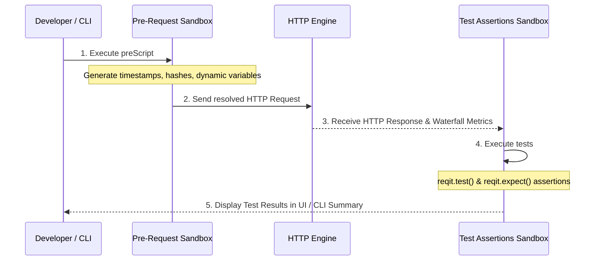

# Pre-Request Scripts & Test Assertions

Reqit provides a secure, lightweight JavaScript execution sandbox for dynamic pre-request configuration and post-request test assertions.

---

## Script Execution Lifecycle



---

## 1. The `reqit.*` API Reference

### `reqit.request` (Pre-Request Context)

Access and mutate the outgoing request before it is sent:

- `reqit.request.method`: Read or write the HTTP method (`'GET'`, `'POST'`, etc.).
- `reqit.request.url`: The target URL string.
- `reqit.request.headers`: Key-value map of headers.
- `reqit.request.setHeader(name, value)`: Adds or overrides an HTTP header.
- `reqit.request.body`: The serialized payload string.
- `reqit.request.setBody(newBody)`: Replaces the payload dynamically.

### `reqit.response` (Post-Request Context)

Inspect the returned server response:

- `reqit.response.status`: Integer HTTP status code (e.g. `200`, `404`).
- `reqit.response.statusText`: Status message (e.g. `'OK'`).
- `reqit.response.headers`: Response headers dictionary.
- `reqit.response.responseTimeMs`: Total roundtrip time in milliseconds.
- `reqit.response.text()`: Returns response body as plain text string.
- `reqit.response.json()`: Parses response body as a JavaScript object (throws if invalid JSON).

### `reqit.variables` & `reqit.environment`

- `reqit.variables.get('token')`: Retrieves a variable from the cascading hierarchy.
- `reqit.variables.set('token', 'xyz')`: Sets a variable in the in-memory **Runtime** scope.
- `reqit.variables.delete('token')`: Removes a runtime variable.
- `reqit.environment.name`: The string name of the currently active environment (e.g. `'production'`).

---

## 2. Writing Pre-Request Scripts

Common pre-request use cases include generating nonces, signatures, or dynamic payloads:

```javascript
// Pre-Request Script example: Dynamic HMAC and timestamp
const timestamp = Math.floor(Date.now() / 1000);
reqit.request.setHeader('X-Timestamp', timestamp.toString());

// Generate dynamic correlation ID in runtime scope
reqit.variables.set('correlationId', 'req_' + Math.random().toString(36).substring(7));
```

---

## 3. Writing Test Assertions

Reqit includes a built-in assertion library using familiar `reqit.test()` and `reqit.expect()` methods:

```javascript
// Check HTTP status code
reqit.test('Status is 200 OK', function () {
  reqit.expect(reqit.response.status).toBe(200);
});

// Check response time performance SLA
reqit.test('Response latency is under 500ms', function () {
  reqit.expect(reqit.response.responseTimeMs).toBeLessThan(500);
});

// Parse and assert JSON structure
reqit.test('Response contains valid user details', function () {
  const data = reqit.response.json();

  reqit.expect(data.id).toBeDefined();
  reqit.expect(data.email).toContain('@example.com');
  reqit.expect(data.role).toBe('admin');

  // Chain tokens for subsequent requests
  reqit.variables.set('userId', data.id);
});
```

### Supported Matchers

- `.toBe(expected)`: Strict equality (`===`).
- `.toEqual(expected)`: Deep object/array equality.
- `.toContain(substringOrItem)`: String substring or Array element inclusion.
- `.toBeDefined()` / `.toBeUndefined()`: Existence checks.
- `.toBeNull()` / `.toBeTruthy()` / `.toBeFalsy()`.
- `.toBeGreaterThan(number)` / `.toBeLessThan(number)`.
- `.toMatch(regex)`: Regular expression pattern matching.

---

## 4. Sandbox Security & Hardening

Untrusted scripts from shared repositories are run in a hardened Node.js sandbox:

- **No Access to Node.js Internals:** `require`, `fs`, `child_process`, and `process` are inaccessible.
- **Hard Execution Timeout:** Scripts that attempt infinite loops (`while(true)`) are terminated automatically after **3000ms**, preventing app freezing.
- **Memory Quota:** High memory allocations are sandboxed to avoid memory exhaustion attacks.
