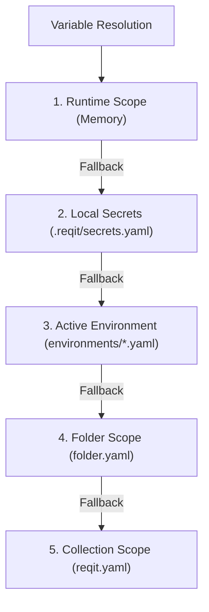

# Variables & Secrets Hierarchy

Reqit features a multi-tiered variable resolution engine that eliminates hardcoding values and ensures sensitive credentials never leak into version control.

---

## The 5-Level Cascading Hierarchy

When a variable like `&#123;&#123;baseUrl&#125;&#125;` or `&#123;&#123;authToken&#125;&#125;` is encountered, Reqit evaluates scopes in strict precedence order from highest to lowest:



| Precedence      | Scope           | Source                     | Git Status          | Typical Use Case                                |
| --------------- | --------------- | -------------------------- | ------------------- | ----------------------------------------------- |
| **1 (Highest)** | **Runtime**     | `reqit.variables.set(...)` | In-memory only      | Dynamic tokens extracted during test execution  |
| **2**           | **Secrets**     | `.reqit/secrets.yaml`      | **Never committed** | Passwords, private API keys, client secrets     |
| **3**           | **Environment** | `environments/<name>.yaml` | Committed to Git    | Hostnames (`baseUrl`), ports, environment flags |
| **4**           | **Folder**      | `<folder>/folder.yaml`     | Committed to Git    | Folder-specific path prefixes, API versions     |
| **5 (Lowest)**  | **Collection**  | `reqit.yaml`               | Committed to Git    | Global defaults, fallback timeouts, API names   |

---

## Variable Syntax & Usage

Variables use double curly brace syntax: `&#123;&#123;variableName&#125;&#125;`. You can use variables anywhere in your request:

- **URL Bar:** `&#123;&#123;baseUrl&#125;&#125;/v1/users/&#123;&#123;userId&#125;&#125;`
- **Headers:** `Authorization: Bearer &#123;&#123;token&#125;&#125;`
- **Query Parameters:** `?apiKey=&#123;&#123;apiKey&#125;&#125;&filter=&#123;&#123;filterBy&#125;&#125;`
- **Request Body (JSON / Text / GraphQL):**
  ```json
  {
    "organizationId": "{{orgId}}",
    "timestamp": "{{currentTimestamp}}"
  }
  ```
- **Authentication:** In Bearer token, Basic Auth username/password, or API Key fields.

---

## Live Autocomplete & Hover Preview

1. **Autocomplete:** Typing <kbd>&#123;&#123;</kbd> in the URL bar, Header inputs, or Body editor triggers instant auto-completion listing all active variables along with their resolved values and scope badges.
2. **Hover Tooltip:** Hovering your mouse over any `&#123;&#123;variable&#125;&#125;` displays a floating tooltip revealing:
   - **Resolved Value:** The exact string that will be sent across the wire.
   - **Source Scope:** e.g. `[Environment: staging]` or `[Secrets]`.
   - **Warning:** A red indicator if the variable is unresolved/undefined.

---

## Secrets Management & Git Safety

Credentials should never be committed into public or private Git repositories. Reqit solves this natively:

1. **Automatic Gitignore Enforcement:** Whenever a collection is created or opened, Reqit checks if `.reqit/` is covered by your repository's `.gitignore`. If not, Reqit safely appends `.reqit/` automatically.
2. **Secret Masking:** In the UI, secret values are masked by default (`••••••••`).
3. **Log Sanitization:** When generating diagnostic reports or copying logs, all secret values matching sensitive keys are automatically redacted.
4. **CI/CD Injection:** In automated pipelines where `.reqit/secrets.yaml` does not exist on disk, `@reqit/cli` allows injecting secrets via environment variables:
   ```bash
   export REQIT_SECRET_apiKey="ci_secret_token_123"
   reqit run ./api --env staging
   ```
